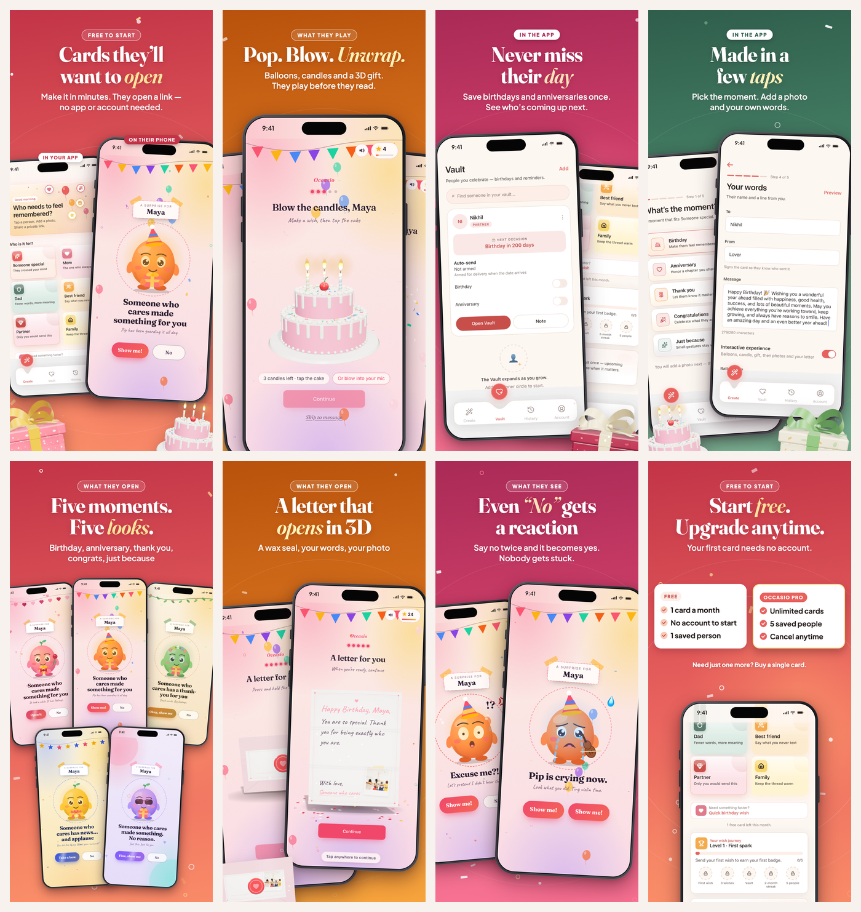
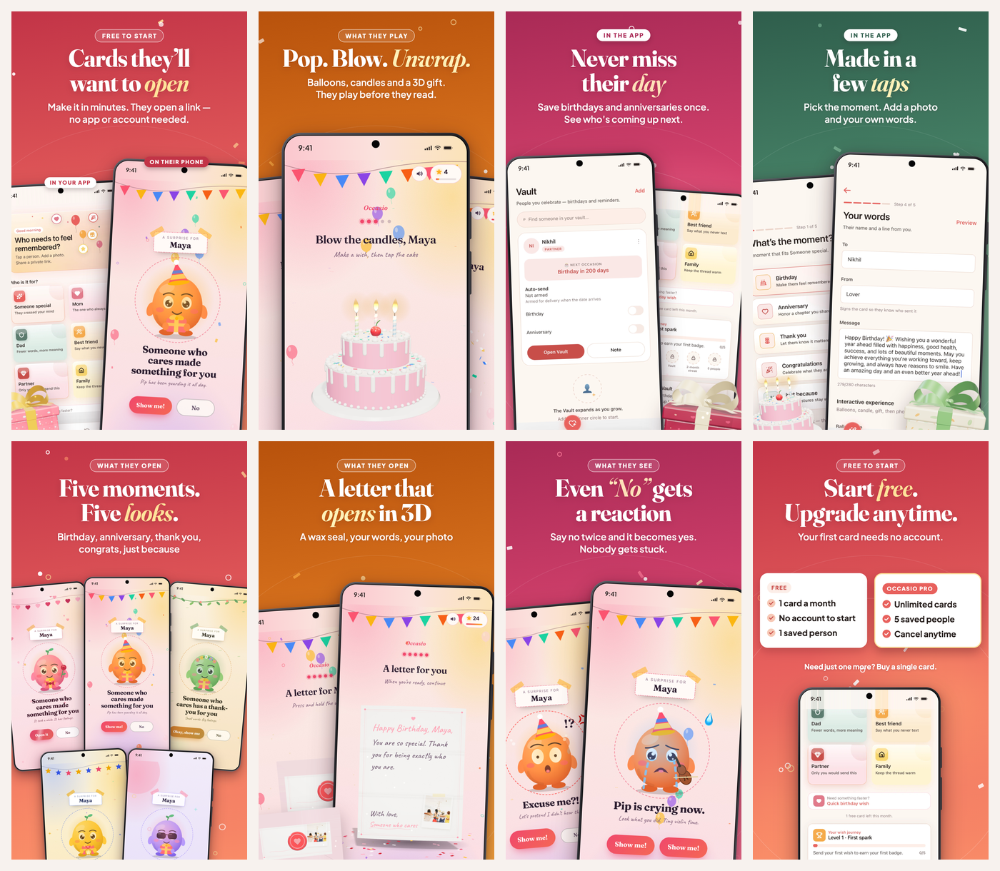

# 04 · Listing assets

Everything is within the limits in `02-research.md` §6. Character counts are machine-checked (`python3 tools/check-limits.py`, sources in `metadata/metadata.json`). **★ marks my recommended option in every set**, each with one line of reasoning.



## 0. Read this first

**Claims gate.** Copy below is written for what is verified in code today. Blocks marked **[ADD AFTER VERIFIED]** describe the on-their-day card preparation (auto-send) and must stay out until you have seen it work on a production build (`03-positioning.md` §5). Strings that need your input are in `[SQUARE BRACKETS]`: `[PRICE]`, `[SUPPORT EMAIL]`.

**What is already built for you** (`images/`, all exact store sizes, opaque, verified by `tools/finalize.py`):

| Slot | File |
|---|---|
| App Store icon 1024×1024 (the icon that ships) | `images/app-store/app-icon-1024.png` |
| iPhone 6.9″ screenshots 1320×2868 (8) | `images/app-store/iphone-6.9/01…08` |
| iPhone 6.3″ screenshots 1206×2622 (8): **the size your App Store Connect "medium display" slot asks for** | `images/app-store/iphone-6.3/01…08` |
| App Store header and search-result assets (optional, iOS 27+; check Apple's template first) | `images/app-store/header-and-search/` |
| Play icon 512×512 | `images/google-play/app-icon-512.png` |
| Play feature graphic 1024×500 | `images/google-play/feature-graphic-1024x500.png` |
| Play phone screenshots 1080×1920 (8) | `images/google-play/phone/01…08` |
| Icon concepts 1024×1024 + comparison sheet | `images/icons/` |

Rebuild or change copy: `node tools/build.mjs && python3 tools/finalize.py` (Node 22+, Chrome/Brave/Edge, Python Pillow). Copy lives in `tools/slides.mjs` (`COPY`).

---

# Part A · Apple App Store

## A1. App name (30)
| # | Name | Count | Why |
|---|---|---|---|
| 1 ★ | `Occasio: Birthday Cards` | 23/30 | The biggest intent term sits in the highest-weight field, and "wish" and "reminder" go in the subtitle and keywords so no word is paid for twice |
| 2 | `Occasio: Birthday Wish Cards` | 28/30 | "Wish" is how India searches; costs a repeated word with subtitle #1 |
| 3 | `Occasio: Cards & Reminders` | 26/30 | Names both jobs, but gives up the largest query ("birthday") |

## A2. Subtitle (30)
| # | Subtitle | Count | Why |
|---|---|---|---|
| 1 ★ | `Remember dates. Send wishes.` | 28/30 | Says the whole product in four words, covers the reminder and wishes intents, and is true today |
| 2 | `Never forget. Send a surprise.` | 30/30 | More emotional, but "never forget" reads as a guarantee; use after auto-send is verified |
| 3 | `Cards they’ll love to open` | 26/30 | Best hook, no keywords; a conversion test (`05-growth-plan.md` §1, test 3) |
| 4 | `Reminders & Surprise Wishes` | 27/30 | Keyword-dense, but flat to read |
| 5 | `Save dates. Send a surprise.` | 28/30 | Action pair; "surprise" is a search term |

## A3. Keyword field (100 bytes, no repeats of title/subtitle words)
| # | Keywords | Bytes | Why |
|---|---|---|---|
| 1 ★ | `reminder,anniversary,greeting,ecard,personalized,surprise,interactive,photo,thank,congrats,widget` | 97/100 | Every term is something the app does today; "interactive" is the low-competition differentiator; Apple pairs these with "birthday"/"cards" from the title |
| 2 | `reminder,anniversary,countdown,widget,upcoming,family,mom,dad,partner,friend,love,memory,greeting` | 97/100 | Reminder-led variant for test angle A (`03-positioning.md` §6) |

Left out on purpose: *whatsapp, instagram* (trademarks), *free, best* (misleading), *gift, calendar* (wrong intent), and any word already in the name or subtitle.

## A4. Promotional text (170; editable any time, not indexed)
| # | Text | Count | Why |
|---|---|---|---|
| 1 ★ | `Make a birthday card they’ll want to open: pop balloons, blow out candles, unwrap a 3D gift. Free to start, and they need no app or account to open it.` | 151/170 | Leads with the play, then removes both objections (price, recipient friction) |
| 2 | `Save the birthdays that matter, then make a card just for them. Your photos, your words, a private link. Free to start, no account needed.` | 138/170 | Memory-led; swap in for the reminder test |
| 3 | `Make a Mother’s Day card with her photo and your words. She opens a private link, no app needed. Free to start, no account required.` | 132/170 | Seasonal template; swap the occasion each campaign (`05-growth-plan.md` §5) |

## A5. Description (4,000; first two lines are benefit-led and are what shows before "more")

File: `metadata/en-US/ios-description.txt` (2,150 characters). Reproduced here:

```
Make the people you love feel remembered.

Create a birthday or anniversary card from your own photos and words. They open a private link and play it: pop balloons, blow out candles, unwrap a 3D gift, read your letter. No app and no account needed on their side.

HOW IT WORKS
1. Pick who it is for and the moment: birthday, anniversary, thank you, congratulations or just because.
2. Add up to 5 photos and write your message. Preview the card before you share it.
3. Share the private link by text or any messaging app. Only people with the link can open it.

WHAT THEY OPEN
Not a flat picture, a small surprise. Balloons to pop, candles to blow out, a gift to unwrap, reasons they open one by one, and a letter with a wax seal. Even tapping "No" gets a reaction.

FIVE MOMENTS, FIVE LOOKS
Birthday, anniversary, thank you, congratulations and just because. Each has its own colours, scenes and sounds.

REMEMBER EVERY DATE
Save the people who matter, with their birthdays and anniversaries. See who is coming up on your Create screen and on your home screen with widgets, so you can start a card in a minute instead of a panic.

PRIVATE BY DESIGN
- Card links are unlisted and not searchable.
- Lock any card with a 4-digit passcode.
- Delete your account and everything in it from inside the app.

START FREE
- Make and share your first card with no account.
- Free: 1 card a month and 1 saved person.
- Occasio Pro: unlimited cards and up to 5 saved people. Need just one more card? Buy a single card instead.

SUBSCRIPTION INFORMATION
Occasio Pro is an auto-renewing subscription, billed monthly at [PRICE] or yearly at [PRICE]. Payment is charged to your Apple ID account at confirmation of purchase. The subscription renews automatically unless it is cancelled at least 24 hours before the end of the current period, and your account is charged for renewal within 24 hours before the end of the current period. You can manage or cancel your subscription any time in your Apple ID account settings.

Terms of Use: https://occasio-greetings.vercel.app/terms
Privacy Policy: https://occasio-greetings.vercel.app/privacy
Support: [SUPPORT EMAIL]
```

**[ADD AFTER VERIFIED]**: insert this block after "REMEMBER EVERY DATE" (`metadata/en-US/ios-on-their-day-block.txt`):

```
ON THEIR DAY (Occasio Pro)
Arm a saved person and Occasio prepares their card on the day and sends you a notification to review it. You get a two-hour window to approve or cancel, then send the link.
```

*Why this shape:* the description is not indexed on iOS, so it is written to convert, not to rank: promise first, three-step proof, then trust (private, deletable), then the plain price story. The subscription block meets Apple 3.1.2 (term, renewal, cancellation, Terms and Privacy links); fill `[PRICE]` for each product.

## A6. Store admin (so nothing blocks review)

| Field | Value | Why |
|---|---|---|
| Primary category | **Lifestyle** | Where BirthdayAlarm and the countdown apps sit |
| Secondary | **Entertainment** (alt: Photo & Video) | Play-with-a-card is entertainment; Photo & Video would pit you against editors. Avoid Social Networking: it invites extra user-generated-content scrutiny |
| Age rating | Answer honestly. Cards are user-generated and shared by private link, so expect **4+, or 12+** if the questionnaire reads that as unrestricted UGC | Do not pick "Made for Kids" |
| Privacy labels | Contact info (email), User content (photos, messages), Identifiers (push token), Purchases; people-in-Vault data is third-party personal data you collect from the user, so declare it | Linked to user; none used for tracking unless you add an ads/attribution SDK |
| Support URL / Marketing URL | `https://occasio-greetings.vercel.app` | Must show real contact info (1.5). The email on it looks mistyped; fix it, and hide the *Google Play internal test* buttons on the landing page before review (2.3.10) |
| Privacy policy / Terms / Delete account | `/privacy` · `/terms` · `/delete-account` on the same host | Confirm all three load in production |
| Export compliance | Standard HTTPS only (exempt). **ASSUMPTION** | Confirm in App Store Connect |
| iPad | Not offered (the build is iPhone-only), so no iPad screenshots are needed | |
| Subscription review screenshot | The RevenueCat paywall showing price, period, auto-renew text, Terms and Privacy links, and Restore | Apple rejects paywalls missing these |

**App Review notes:** the full, final text (2,756 of 4,000 bytes) is `metadata/en-US/app-store-connect/10-app-review-notes.txt`; every other App Store Connect field has a paste-ready file beside it, and `06-apple-submission.md` §5 maps them to the form. Reuse the same notes, minus the Apple-specific paragraphs, for Google Play's *App access* section.

---

# Part B · Google Play

## B1. Title (30)
| # | Title | Count | Why |
|---|---|---|---|
| 1 ★ | `Occasio: Birthday Wish Cards` | 28/30 | Play has no subtitle, so the title carries three searchable words ("birthday", "wish", "cards") without stuffing |
| 2 | `Occasio: Birthday Cards` | 23/30 | Cleaner; use if you want one name on both stores |
| 3 | `Occasio: Cards & Reminders` | 26/30 | Pairs both jobs; weaker on the largest query |

## B2. Short description (80; indexed; the only text above the fold)
| # | Short description | Count | Why |
|---|---|---|---|
| 1 ★ | `Make birthday cards they’ll want to open. Save dates so you never miss one.` | 75/80 | Hook plus the memory benefit, with "birthday cards" and "save dates" both in it |
| 2 | `Interactive birthday cards they play, plus a vault to remember every date.` | 74/80 | Leads with "interactive", the low-competition query |
| 3 | `Pop balloons, blow candles, unwrap a gift. Cards made from your photos.` | 71/80 | Concrete and visual; weaker on keywords |
| 4 | `Save birthdays once. Send a card they’ll love to open. Free to start.` | 69/80 | Reminder-led for test angle A |
| 5 | `Birthday & anniversary cards that feel like a gift. No account to start.` | 72/80 | Friction-led for test angle B; covers anniversary |

(Play's metadata policy bars price and promotional claims in the title, icon and developer name, so "free" stays out of the titles above. If review objects to "free" in the short description or the graphics, drop "Free to start." from #4 and use the *No account needed* pill.)

## B3. Full description (4,000; indexed)

File: `metadata/en-US/play-full-description.txt` (2,224 characters). It repeats the target phrases naturally (birthday cards, anniversary cards, thank you cards, "vault" and "coming up" for the reminder intent) and avoids keyword lists, which Play treats as stuffing.

```
Make birthday cards they'll want to open.

Occasio turns your photos and a few words into an interactive birthday or anniversary card. Share a private link and they pop balloons, blow out the candles, unwrap a 3D gift and read your letter. They don't need the app or an account to open it, and you can make your first card without signing up.

WHY PEOPLE USE OCCASIO
- A birthday card that feels like a gift, not a forwarded image
- Anniversary, thank you, congratulations and just-because cards too
- A vault for the birthdays and anniversaries of the people who matter, with home-screen widgets
- Private links, an optional passcode lock, and account deletion inside the app

HOW IT WORKS
1. Pick who the card is for and the moment.
2. Add up to 5 photos and write your own words. Preview it.
3. Share the private link by text or any messaging app. Only people with the link can open it.

WHAT THEY OPEN
Balloons to pop. Candles to blow out. A 3D gift to unwrap. Reasons they open one by one. A letter with a wax seal. Even tapping "No" gets a reaction from Pip, who guards the gift.

FIVE MOMENTS, FIVE LOOKS
Birthday cards, anniversary cards, thank you cards, congratulations cards and just-because cards. Each moment has its own colours, scenes and sounds.

REMEMBER EVERY DATE
Save the people you care about with their birthdays and anniversaries. See who is coming up on the Create screen and in a home-screen widget, so you can start a birthday card in a minute instead of a panic.

PRIVATE BY DESIGN
- Card links are unlisted and not searchable
- Lock any card with a 4-digit passcode
- Delete your account and everything in it from inside the app

START FREE
- Make and share your first card without an account
- Free plan: 1 card a month and 1 saved person
- Occasio Pro (monthly or yearly subscription): unlimited cards and up to 5 saved people
- Need just one more card? Buy a single card instead

Subscriptions renew automatically unless cancelled at least 24 hours before the end of the current period. Manage or cancel any time in Google Play, under Payments and subscriptions.

Terms: https://occasio-greetings.vercel.app/terms
Privacy: https://occasio-greetings.vercel.app/privacy
Support: [SUPPORT EMAIL]
```

**[ADD AFTER VERIFIED]** the same "ON THEIR DAY (Occasio Pro)" block as A5 goes after "REMEMBER EVERY DATE" (`metadata/en-US/play-on-their-day-block.txt`).

## B4. Feature graphic (1024×500)

`images/google-play/feature-graphic-1024x500.png`

- **Copy:** headline *Cards they’ll want to open* (the screenshot-1 promise, so the page says one thing three times); line *Birthday cards & reminders* (the two jobs, plain).
- **Visual:** the shipped icon and the wordmark top-left for recall; two phones fan out on the right showing the recipient's gate (Pip) and the candle scene; the 3D gift peeks in; coral brand gradient.
- **Why:** the feature graphic is the first thing in featured placements and the video thumbnail; it needs one idea, a face (Pip) and a brand mark. Text stays inside the centre-left safe area because Play crops edges on some surfaces.

## B5. Store admin

| Field | Value | Why |
|---|---|---|
| Category | **Lifestyle** | Play has no greeting-cards category |
| Tags | Pick the closest in the console: Greeting cards, Birthday, Reminders/Calendar, Photo, Social | Tags feed discovery on the category pages |
| Content rating (IARC) | Expect **Everyone**; declare user-generated content shared by link | Do not tick "no UGC" |
| Target audience | **18+** | Avoid the Families programme obligations |
| Ads | None | |
| Data safety | Email (Auth), photos and messages (card content), names/dates/contact of *other people* (Vault), push token, purchase history; encrypted in transit; deletion available in-app and at `/delete-account` | Be explicit that Vault holds third-party personal data |
| Account deletion URL | `https://occasio-greetings.vercel.app/delete-account` | Required for apps with account creation |
| App access | Guest creation works; reviewer notes as in A6 | |
| Contact email | `[SUPPORT EMAIL]` (the repo currently shows an address that looks mistyped; change it to one you will keep) | Public on the listing |

## B6. What's new (500 per locale)

**1.0:** `Welcome to Occasio. Make a birthday or anniversary card from your photos and words, share a private link, and save the dates of the people who matter.` (150/500)

---

# Part C · Shared creative

## C1. Screenshot storyboard (8 frames, both stores)



Rules applied: one idea per frame; headline ≤6 words; benefit before feature; **frames 1–3 each carry the install decision alone**; every frame says plainly whether it shows the app or what the recipient opens; four of eight frames are real app screens; brand hues only (coral, amber, rose, sage).

| # | Headline (≤6 words) | Supporting line | Screen(s) shown (file in `tools/src/screens/` · route/source) | Visual treatment | Job |
|---|---|---|---|---|---|
| **1** | **Cards they’ll want to open** (5) | Make it in minutes. They open a link — no app or account needed. | `home.jpg` = **CreateHome** (`CreateHomeScreen.tsx`, labelled *In your app*) + `gate.jpg` = recipient **GateScene** at `/c/demo-birthday-maya-1408` (labelled *On their phone*) | Coral. Two phones, the native one behind and tilted left, Pip's gate in front; 3D gift and cake peek from the bottom corners. Pill: *Free to start* | The whole business in one glance: you make it here, they play it there |
| **2** | **Pop. Blow. Unwrap.** (3) | Balloons, candles and a 3D gift. They play before they read. | `balloons.jpg` (BalloonPopScene) · `candle.jpg` (CandleScene) · `gift-open.jpg` (GiftScene), all recipient, `?scene=` on the demo card | Marigold. Three phones fanned, the candle cake large in the middle. Pill: *What they play* | Proof of "interactive": a verb per scene |
| **3** | **Never miss their day** (4) | Save birthdays and anniversaries once. See who’s coming up next. | `vault.jpg` = **VaultList** (`VaultListScreen.tsx`, "Next occasion: Birthday in 200 days") + `home-scroll.jpg` = CreateHome scrolled (Vault nudge) | Rose. Vault phone in front, Create behind; gift peeks in. Pill: *In the app* | The retention story, from real screens only |
| 4 | Made in a few taps (5) | Pick the moment. Add a photo and your own words. | `moment-picker.jpg` = **Occasion** (`OccasionScreen.tsx`) + `words.jpg` = **Details** (`DetailsScreen.tsx`, To / From / Message) | Sage. Two native phones side by side; gift and cake peek. Pill: *In the app* | Lowers effort anxiety; shows personalisation fields |
| 5 | Five moments. Five looks. (4) | Birthday, anniversary, thank you, congrats, just because | Five recipient gates: `gate`, `anniversary-gate`, `thank_you-gate`, `congratulations-gate`, `just_because-gate` | Coral. Five phones in a 3+2 stack; each has its own Pip costume and colours. Pill: *What they open* | Breadth beyond birthdays; widens search relevance |
| 6 | A letter that opens in 3D (6) | A wax seal, your words, your photo | `letter-sealed.jpg` + `letter-open.jpg` = **Letter3DScene** (`docs-site/src/components/story/Letter3DScene.tsx`) | Marigold. Two phones; an envelope peeks in. Pill: *What they open* | The premium, craft moment |
| 7 | Even “No” gets a reaction (5) | Say no twice and it becomes yes. Nobody gets stuck. | `gate-no1.jpg` + `gate-no2.jpg` = **GateScene** after the first and second "No" | Rose. Two phones: Pip startled, Pip crying. Pill: *What they see* | Humour = shareability and word of mouth; also states the "no dark patterns" rule |
| 8 | Start free. Upgrade anytime. (4) | Your first card needs no account. | Generated plan cards (*Free: 1 card a month · No account to start · 1 saved person* vs *Occasio Pro: Unlimited cards · 5 saved people · Cancel anytime*) + `home-scroll.jpg` showing "1 free card left this month." Line: *Need just one more? Buy a single card.* | Coral. Two white cards over the real Create screen. Pill: *Free to start* | States the paid plan *before* the paywall, which protects ratings (the PRD's top risk) and pre-qualifies buyers |

**Prices are deliberately absent from images** (they vary by country and currency). If Play review objects to the word "free" in graphics, swap the pill on frames 1 and 8 to *No account needed* (one line in `tools/slides.mjs`).

**Why the labels and the four native frames:** seven of eight frames could have shown only the recipient's web page, which looks best but is not the app; Apple 2.3.3 wants screenshots that show the app in use. The labels make the two-sided product clear to users, too.

**Why I did not use "Choose a frame" and "Preview":** the captured versions show a real person's photo. Retake them with a licensed or consenting photo and they become frames 4b and 9.

## C2. Retake list (optional upgrades; the set ships as is)

All go in `tools/src/screens/` as `.jpg`, same names, then `node tools/build.mjs && python3 tools/finalize.py`. Use fictional names and licensed photos.

| Priority | Retake | Seed data | Why |
|---|---|---|---|
| 1 | **Vault with 3 people** (`vault.jpg`) | Sign in; add "Mom" (birthday in 3 days), "Arjun" (anniversary in 12 days), "Priya" (birthday in 30 days) | Replaces the single test person "Nikhil" and the "Not armed" empty feel; strongest retention proof |
| 2 | **Create home with "Coming up"** (`home.jpg`) | With the people above, so the hero reads "A moment for Mom?" | Shows the product reminding you |
| 3 | **Review send** (new frame: "Approve before it’s sent") | Needs a real pending send; screen *Review send*, "1 hour left to review", *Approve & send* / *Cancel send* | Your strongest trust message; **only after auto-send is verified** |
| 4 | **Your link is ready** (ShareSuccess) | After "Create the link" | Closes the loop in-app |
| 5 | **Home-screen widgets** (iOS and Android) | Next up + Coming up | A real screenshot of the reminder surface |
| 6 | **Android-native captures** for the Play set | Run on a Pixel emulator | Play shots currently use iOS captures in a phone frame; fine, but not strictly Android |

## C3. Preview video script

**Specs:** 15–30 s. App Store: portrait **886×1920**, H.264, ≤30 fps, ≤500 MB, captions not voice (it autoplays muted), must be **captured from the app**. Google Play: a public/unlisted YouTube link, 9:16 or 16:9. No voiceover needed. Music optional (licensed only).

**Cut A: Play promo / YouTube, 28 s.**

| Time | Shot | Caption |
|---|---|---|
| 0:00–0:03 | **Hook.** Recipient gate, full screen: Pip, "Someone who cares made something for you." A thumb taps **No**; Pip’s eyes go wide ("Excuse me?!") | *Tap “No”. See what happens.* |
| 0:03–0:05 | Second **No**: Pip cries. Thumb taps **Show me!** | *Pip has feelings.* |
| 0:05–0:09 | Balloons pop, three taps, confetti | *Pop.* |
| 0:09–0:12 | The cake: blow out the candles | *Blow.* |
| 0:12–0:15 | The gift unwraps in 3D | *Unwrap.* |
| 0:15–0:18 | **Cut to the app.** Create home, tap **Mom** | *Now make yours.* |
| 0:18–0:22 | Fast: moment → photo → type “Happy birthday, Mom” → Preview | *A few taps. No account.* |
| 0:22–0:25 | **Create the link** → share sheet → send | *Send a private link.* |
| 0:25–0:28 | Vault list: "Mom · Birthday in 3 days"; end card: icon, **Occasio**, line | *Never miss their day. Occasio: cards they’ll want to open.* |

**Cut B: App Store preview, ≤22 s, in-app footage only.** Apple wants footage from the app, so drop the recipient shots (0:00–0:15) or keep only what plays inside the app. Open on Create home → Mom → moment → photo → words → Preview ("This is what they’ll open") → Create the link → Your link is ready → Vault list, with the same captions. *Risk:* a recipient page opens in the browser, outside the app; keep that out of the App Store cut unless App Review says otherwise.

*Why this shape:* the first three seconds are the only ones that decide a scroll-past, so they show the one thing nobody else has: a mascot reacting to a tap. The middle proves the verbs, the end proves it is easy and that it remembers.

## C4. Icon concepts

`images/icons/_icon-comparison.png` shows the icon that ships and three new concepts at store size and at 120/60/29 px.

| | Concept | What it says | Risk |
|---|---|---|---|
| Control | **Gift Heart (3D), what ships today** | Love and a gift, rich and tactile; stands out from the flat icons in the category | Detailed: the ribbon ring blurs at 29 px; reads as "gift" more than "card" or "reminder" |
| **A ★** | **Sealed Heart.** Cream envelope, coral heart as a seal, on a coral gradient | "A card with love in it" in a single silhouette; flat, so it survives small sizes | Envelope icons are common (mail apps); the heart carries the difference |
| B | **Pip.** The mascot in a party hat on rose | Personality and play; the character recipients meet; ownable | Skews toward a kids/games look, against the "calm, trustworthy" sender tone |
| C | **Date Heart.** Calendar page with a coral heart, on amber | "Remember the date" instantly; best for reminder-intent searchers | Reads as a calendar app first, a card app second |

**Recommendation:** ship v1.0 with the icon already in the build (zero risk, no new binary), and run **Concept A as the challenger** (Play Store listing experiments test icons directly; on iOS, Product Page Optimization needs the alternate icon bundled in the app). *Why A:* it is the only concept that says "card" and "love" at 29 px without relying on detail.

## C5. In-app purchases and subscription names

| Store | Product | Display name | Count | Description | Count |
|---|---|---|---|---|---|
| Apple (group "Occasio Pro") | `occasio_pro_monthly` | `Occasio Pro Monthly` | 19/30 | `Unlimited cards. Save up to 5 people.` | 37/45 |
| Apple | `occasio_pro_yearly` | `Occasio Pro Yearly` | 18/30 | `Unlimited cards. Save up to 5 people.` | 37/45 |
| Apple (consumable) | `occasio_wish_single` | `One Extra Wish` | 14/30 | `One more card beyond your free monthly card.` | 44/45 |
| Google Play | subscription `occasio_pro` (base plans: monthly, yearly) | `Occasio Pro` | ≤55 | Benefits: *Unlimited cards* · *Save up to 5 people* | n/a |
| Google Play (one-time) | `occasio_wish_single` | `One Extra Wish` | ≤55 | `One more card beyond your free monthly card.` | n/a |

**[ADD AFTER VERIFIED]** change both subscription descriptions to `Unlimited cards. Cards ready on their day.` (42/45) and add the benefit *Cards prepared on their day*.

*Why plain names:* the in-app paywall and the store receipt must match, because mismatched names cause "what am I being charged for?" refunds. The yearly is not described as "best value": no price exists in the project to compare, and the claim would be unverifiable.

**Price recommendation (not a fact from the project):** start from the PRD's India targets, **₹149/month and ₹999/year**, and consider a US yearly in the **$19.99** range, which undercuts the annual plans seen in `02-research.md` ($23.99–$47.99) while staying above a single $4.99 pay-per-card rival. Consider a **7-day introductory offer on the yearly** only after analytics exist to see whether it helps or just defers cancellations.

## C6. What's New templates

**App Store (4,000) / Google Play (500)**

```
1.0   Welcome to Occasio. Make a birthday or anniversary card from your photos and words,
      share a private link they can open on any phone, and save the dates of the people who matter.

Update template (keep to what changed, in user words):
Version {x.y}
• {Biggest thing a user will notice, as a benefit}
• {Second change}
• Fixed: {one line per fix users would have felt}
Questions or ideas? {SUPPORT EMAIL}
```

*Why:* users read the first line and the support line. Never write "bug fixes and improvements"; name the fix, because named fixes are the best answer to a negative review.

---

# Part D · Localization

**The app is English-only** (no string tables), so the shipping set is **English**: en-US is the master. Re-use it unchanged for en-GB, en-AU, en-CA and, on Play, en-IN. *Why:* localising a listing into a language the app UI does not speak raises "I can't read it" 1-star reviews and gives you nothing to match the screenshots to.

| Locale | Title | Subtitle / short | Keywords | Screenshot headlines |
|---|---|---|---|---|
| **en-US (master)** | `Occasio: Birthday Cards` (iOS) · `Occasio: Birthday Wish Cards` (Play) | `Remember dates. Send wishes.` · Play short #1 | K1 above | The eight headlines in C1 |
| en-GB / en-AU / en-CA | same | same | same (Apple treats "colours" and "colors" as the same word, no change needed) | same |
| en-IN (Play) | same as en-US Play | Play short #1 | n/a (Play indexes the description) | same |

> Check in App Store Connect whether an **English (India)** localisation exists. If it does, add it with the en-US text. If it does not, the India storefront uses another English set; do not rely on any trick there without testing.

### Optional: Hindi (hi-IN), a draft for later

Hindi is a large, under-served market for this exact job and the PRD is India-first, so it is the first language to add, **but only together with a Hindi app UI** (and Devanagari screenshots), and **a native speaker must review every line**. A draft, ready to drop in when you decide:

| Field | Draft | Limit check |
|---|---|---|
| iOS name | `Occasio: जन्मदिन कार्ड` | 22/30 |
| iOS subtitle | `तारीख़ें याद रखें, बधाई भेजें` | 29/30 |
| iOS keywords | `रिमाइंडर,सालगिरह,बधाई,फोटो,ई-कार्ड` | **92/100 bytes** (Devanagari is 3 bytes a letter, so the field holds far fewer words than English) |
| Play title | `Occasio: जन्मदिन कार्ड` | 22/30 |
| Play short | `ऐसे जन्मदिन कार्ड बनाएं जिन्हें खोलने का मन करे। तारीख़ें सेव करें, कभी न भूलें।` | 80/80 |
| Screenshot headlines 1–8 | खोलने लायक कार्ड · फोड़ें। बुझाएं। खोलें। · कोई तारीख़ न छूटे · बस कुछ टैप में तैयार · पांच मौके, पांच अंदाज़ · 3D में खुलती चिट्ठी · “नहीं” पर भी रिएक्शन · मुफ़्त शुरू करें | ≤6 words each |

To render Hindi screenshots: add a `'hi-IN'` entry to `COPY` in `tools/slides.mjs`, load *Noto Sans Devanagari* in `design.mjs`, and run `LANG_ID=hi-IN node tools/build.mjs`.
