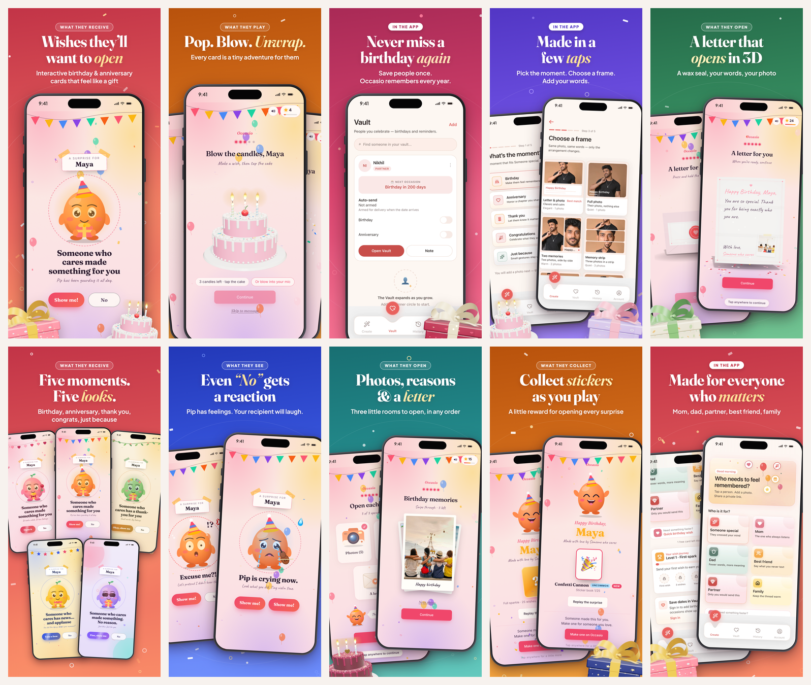

# Occasio — store assets

Everything for the Google Play and App Store listings, generated from the real app and the real recipient pages (nothing mocked up by hand).



## What to upload where

### Google Play Console → Main store listing
| Slot | File |
|---|---|
| App icon (512×512) | `out/google-play/app-icon-512.png` |
| Feature graphic (1024×500) | `out/google-play/feature-graphic-1024x500.png` |
| Phone screenshots (max 8) | `out/google-play/phone/01…08` — 1080×1920 |
| Spare (Play caps at 8) | `out/google-play/phone-spare/09, 10` |
| Title / short / full description | `listing/google-play.md` |

### App Store Connect → App Information / Version
| Slot | File |
|---|---|
| App icon (1024×1024, opaque) | `out/app-store/app-icon-1024.png` |
| iPhone 6.9″ screenshots (max 10) | `out/app-store/iphone-6.9/01…10` — 1320×2868 |
| iPhone 6.5″ (optional) | `out/app-store/iphone-6.5/01…10` — 1284×2778 |
| Name / subtitle / promo / keywords / description | `listing/app-store.md` |

Strategy, keyword reasoning, experiments, localisation, launch checklist and risks: `listing/aso-strategy.md`.

## Before you publish — read these

1. **Slide 4 shows a real person's face** (your test photo in "Choose a frame"). Retake with a stock or consenting person's photo, or accept that knowingly.
2. **Slides 5 and 8 show an Unsplash group photo** (the demo card's photo). Fine to view; swap for a photo you own for a commercial listing.
3. **Seven slides show what the recipient opens (a web page)**, not the app. They're labelled "What they receive / open / play…" on purpose. Keep at least three "In the app" slides.
4. **The Vault slide (3) shows "Auto-send: Not armed"** with an empty state. Retake it with 2–3 people saved and auto-send on — it's your retention story.
5. **Add a "review before it's sent" screenshot** (the 2-hour approve/cancel window). It's your strongest trust message and there's no capture of it yet.
6. **Play set uses iOS-captured native screens** in a Pixel-style frame. For strict accuracy, recapture native screens on an Android emulator and rebuild.
7. Fill the `[PRICE]`, `[SUPPORT EMAIL]`, `[LEGAL NAME]` placeholders; Hindi copy needs a native-speaker review.

## How it's made (so you can change it)

```
src/raw/            your native app screenshots (webp)             ← replace with new captures
src/captures/       recipient-page captures (headless Chrome, 1290×2628 @3x)
src/screens/        cleaned screens used by the layouts            ← built by prepare-screens.py
src/props/          transparent 3D gift / cake / envelope renders from the real three.js scenes
tools/slides.mjs    the 10 layouts — edit headlines, order, colours here
tools/design.mjs    device frames, status bar, palette, confetti
out/                final files
```

```bash
./build.sh      # rebuild all graphics from src/ (≈2 min, no server)
./capture.sh    # only if the recipient UI changed: rebuilds docs-site and re-captures it
```

To retake a native screen: save the new screenshot over the matching file in `src/raw/` (see the number→name map at the top of `tools/prepare-screens.py`), then `./build.sh`.
To change a headline: edit `tools/slides.mjs`, run `PLATFORM=ios node tools/build.mjs 03` to re-render one slide quickly.

Fonts (Fraunces, Plus Jakarta Sans) are SIL OFL — free for commercial use; they load from Google Fonts at render time.
